

<h1 align="center">Kinelight</h1>

<b>Show control for the Mac, built for dance and live shows.</b> 
Patch your lights, build the stage in 3D, busk live and run cues on the music — 
with pyro, haze, a video wall and an iPad or phone remote in the same show.

  <a href="https://kinelight.brnzy.co.uk"><b>Website</b></a> ·
  <a href="https://kinelight.brnzy.co.uk/features">Features</a> ·
  <a href="https://kinelight.brnzy.co.uk/pricing">Pricing</a> ·
  <a href="https://github.com/samjosephburns94-sys/kinelight.app/releases/latest">Download for Mac</a> ·
  <a href="https://kinelight.brnzy.co.uk/faq">FAQ</a>

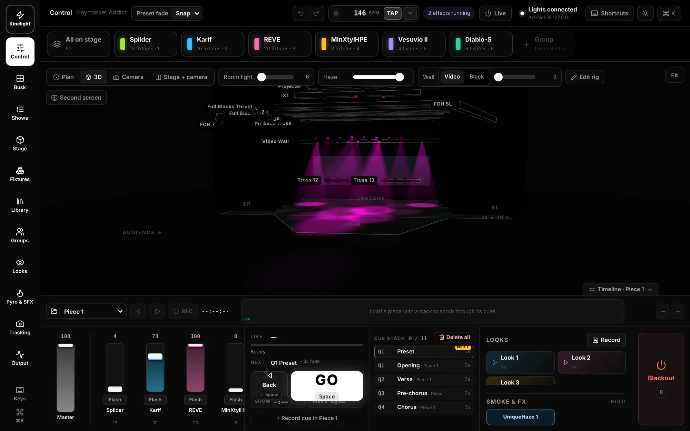

| | |
|---|---|
| 🎛️ **Every light on one screen** | Group tiles, the stage plan, faders, GO and the cue stack — and one big Blackout. |
| 🧊 **The venue in 3D** | Trusses, the video wall and every beam, before you're in the room. |
| 🎚️ **Busk your way** | A busk page built from windows you choose, with layered effects. |
| 🎵 **Cues on the music** | Acts and pieces with their songs, videos and cues on a timeline. |
| 🔥 **Pyro & SFX** | Arm, then fire: flame, CO₂, cold spark, confetti, haze and smoke. |
| 📱 **iPad & phone remote** | Your show in your hand, anywhere on the network. |
| 🌐 **Art-Net & sACN** | As many nodes as you need, with a live network monitor. |
| 🖥️ **Second screens** | The stage, the cue list or the back-wall video on any extra display. |

---

## Control — every light on one screen

Group tiles along the top, your stage plan in the middle, faders, GO and the cue stack along the bottom. Switch the
plan to 3D or a camera and keep Blackout in reach.

- Tap groups to take them, double-tap for just that one
- Plan, 3D, camera, or stage and camera side by side
- Faders with flash, GO and Back with live and next
- Looks, smoke & FX and Blackout always one tap away

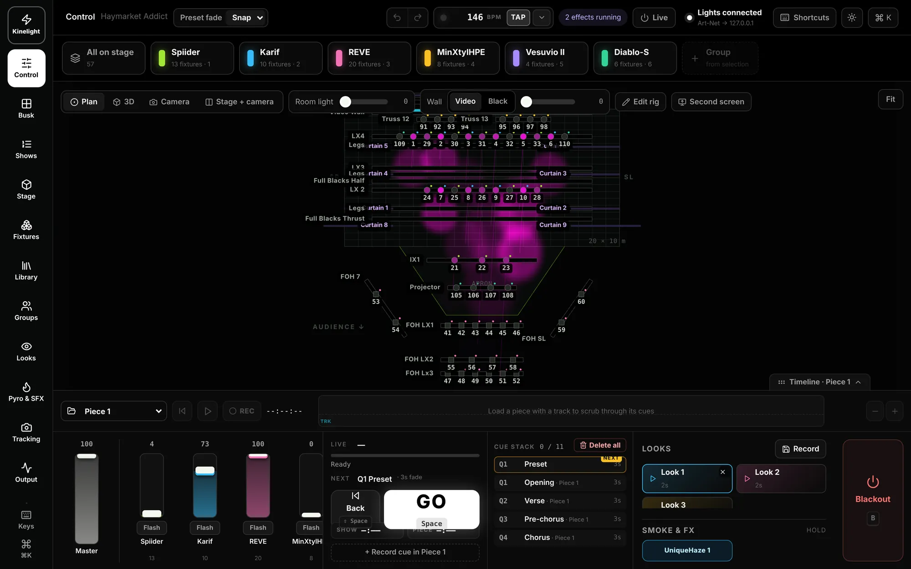

## Stage & 3D — build the venue, then see it

Set the stage, hang trusses and bars, place the video wall and drop your fixtures on. Watch the beams in 3D with
haze before load-in, and save the stage as a venue for next time.

- Width, depth, apron and wings in metres
- Trusses and bars at their real trim heights, at any angle
- The LED or projection wall where it really hangs
- Positions like upstage left and centre, split across the rig

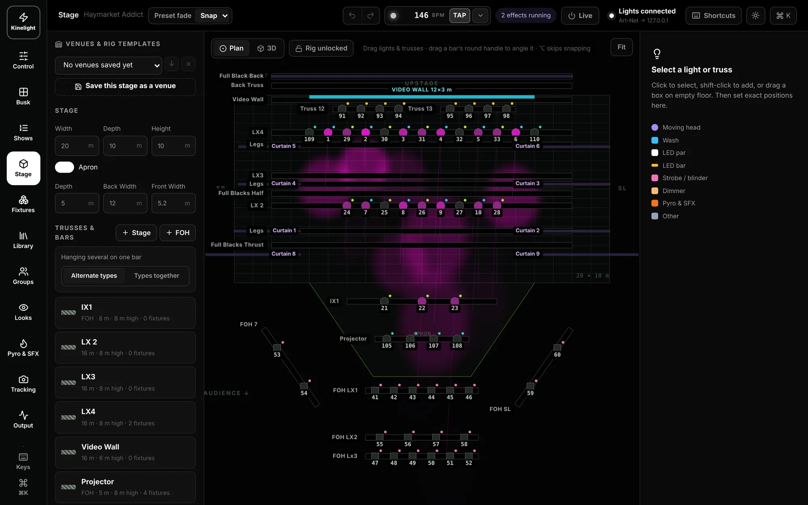

## Busk — a page you build yourself

Windows for groups, colour, tempo, effects, looks, positions and beam: add the ones you want, put them where you like,
pin and lock them. Effects stack in layers, and whatever you busk can be recorded straight into the song.

- Pulse, breathe, chase, strobe, rainbow, colour chase, circle, figure 8, ballyhoo and zoom
- Masters for the size, speed and level of every effect
- A busk fader with 2 s and 5 s fades
- "Touching takes those lights" — grab any light mid-cue

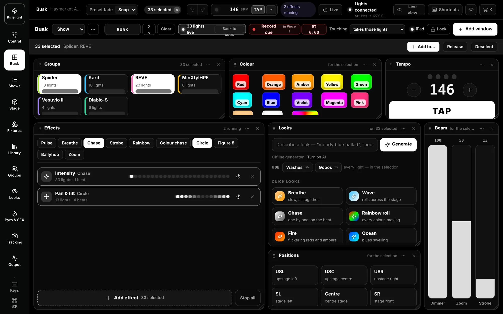

## Shows — acts, pieces and cues on the music

Build the night as acts and pieces. Each piece carries its song, its back-wall video and its rehearsal video, and its
cues sit on the music at the piece's tempo. GO runs it the same way every time.

- Record cues as the track plays
- Pyro lane on the timeline
- Print the cue sheet, jump to any cue
- A pre-show check before the doors open

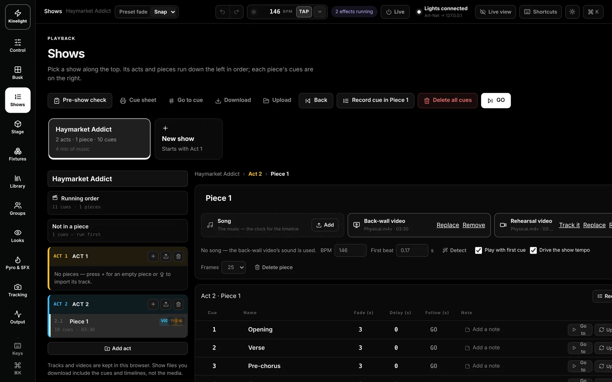

## Looks & gobos — in your own words

Describe a look — *"moody blue ballad"* — and Kinelight builds it. Washes take the colour while spots take gobos,
movement and effects. Every look keeps a thumbnail and fades in over its own time.

- Generate looks, with or without AI
- Gobo wheels read from each fixture's profile — no slot numbers to remember
- Quick looks: breathe, wave, chase, rainbow roll, fire, ocean
- Fire from Control, update in a tap

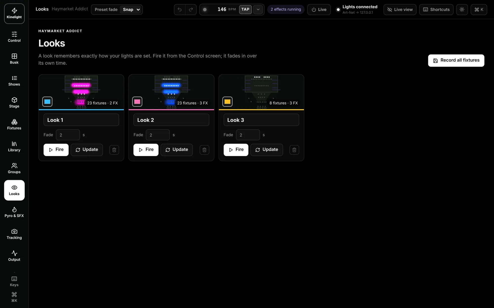

## Pyro & SFX — armed, then fired

Switch packs, launchers, flame, CO₂ jets, confetti and cold spark: arm the system, arm each device, then fire — by
hand or from the timeline. Smoke machines, hazers, fans and bubbles run on a level and stay on through Blackout, so
the room stays hazy.

- Hold to arm, hold to fire
- Pyro and effects cued on the music
- Haze and fans ignore the Grand Master and Blackout
- Looks, cues and effects never fire pyro

> Kinelight triggers pyro through switch packs and DMX; it isn't a certified pyrotechnic firing system. Use each
> device's own hardware interlock and a licensed operator, and keep the area clear.

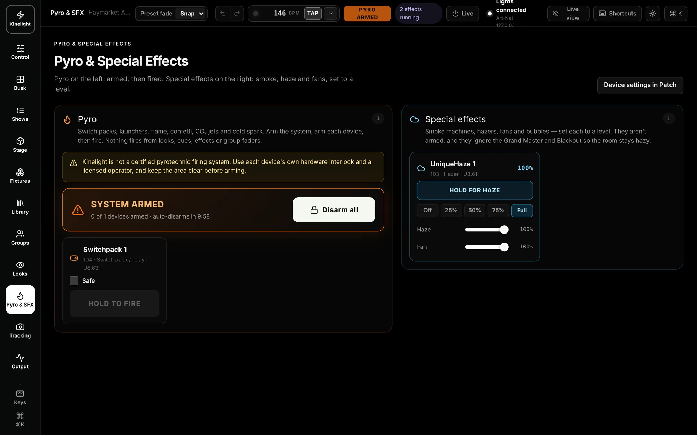

## iPad & phone — your show in your hand

Open the remote on any iPad or phone on the same network. The iPad gets Control, Busk and Stage; the phone gets Run,
Faders, Cues, Focus and Looks. Pick one light or drag a box round ten, then Aim and tap where they should land.

<table>
  <tr>
    <td width="70%">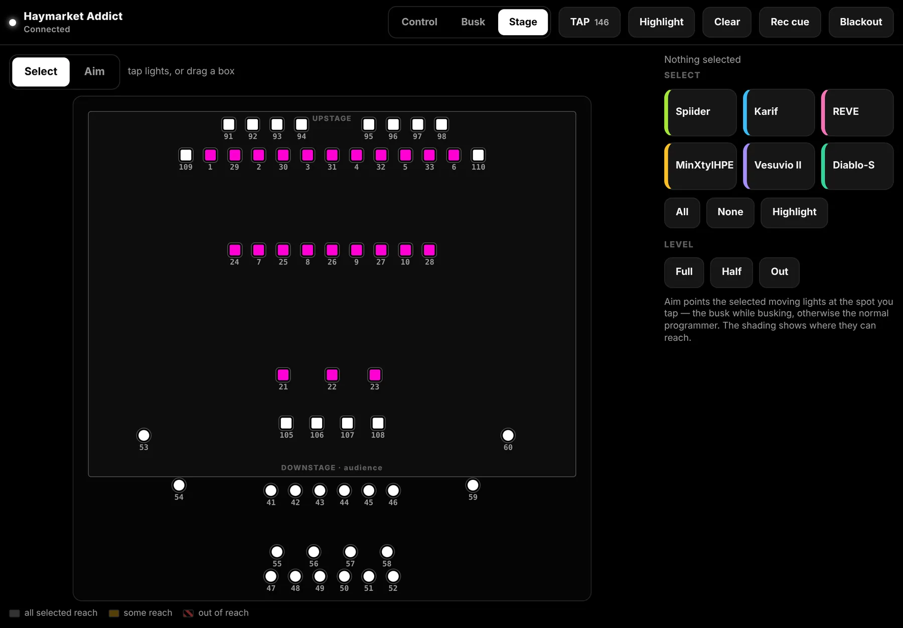</td>
    <td width="30%">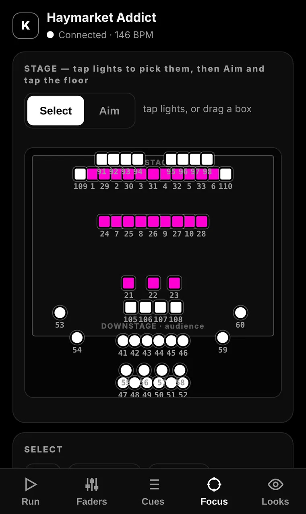</td>
  </tr>
</table>

- Select single or multiple fixtures on the stage grid
- GO, Back, Blackout, faders and looks
- PIN protected, black for dark rooms

## Art-Net & sACN — networking, built in

Send to as many nodes as you need, each Art-Net or sACN, to one address, broadcast or multicast. Drag a universe onto a
node, let **Find nodes** ask the network, and watch every packet, universe and ping live.

- Flags another console sending the same universe — the usual reason lights flash
- Live monitor: frames, packets, ping, OSC, MIDI, the remote and backups
- OSC in and out for QLab, TouchOSC and the rest of your show control

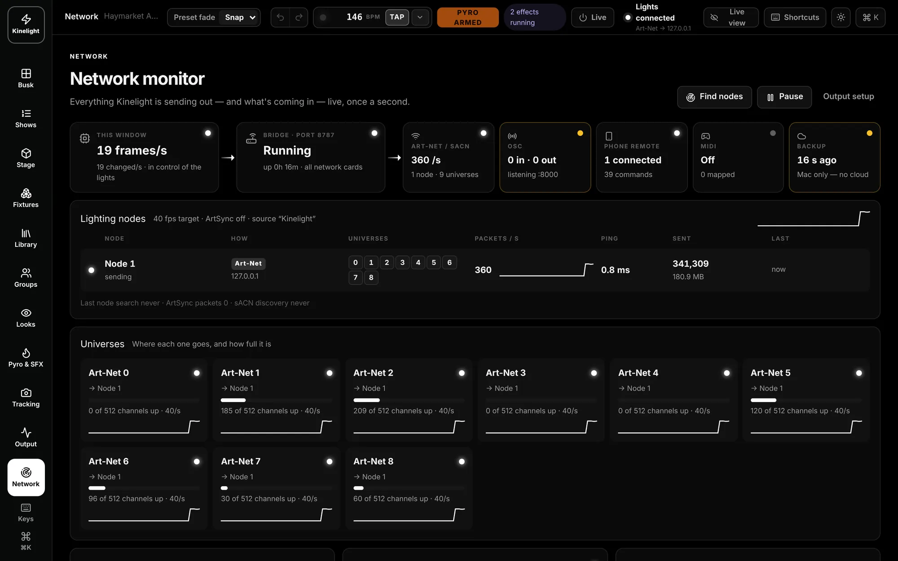

## Second screens & the video wall

Put the stage or the cue list on another monitor or a TV in the wings — it follows the main window live. Send the
back-wall video to its own display, fit or fill it, fade it to black while it keeps running, and choose where the
sound goes.

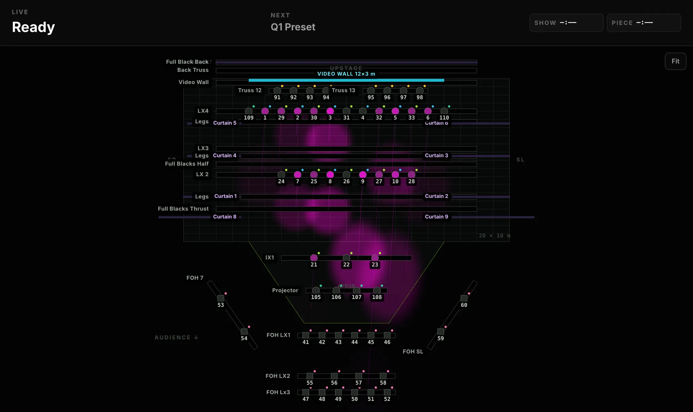

## Made for the kit around a show

- **APC mini mk2** — works the moment it's plugged in: groups, cues, looks and colours on lit pads, GO and Blackout
  down the side, faders for groups and the grand master
- **Any MIDI controller** — press Learn and move a fader or button: groups, the master, any part of a light, effects,
  pyro or GO
- **Stream Deck** — give a key one of Kinelight's shortcuts (Space for GO, B for Blackout), or send OSC like
  `/kinelight/go`, `/kinelight/look/3` and `/kinelight/cue/12`
- **iPad and iPhone** as remotes, and any extra screen for the stage, the cue list or video

## Fixtures — 670 profiles, exact channel orders

Type what you have — *"6 x rgbw par"* — and Kinelight works out the addresses. Pick from the library, refresh it from
the Open Fixture Library, import Avolites or JSON profiles, import a venue's fixture list from a PDF, or build your own.

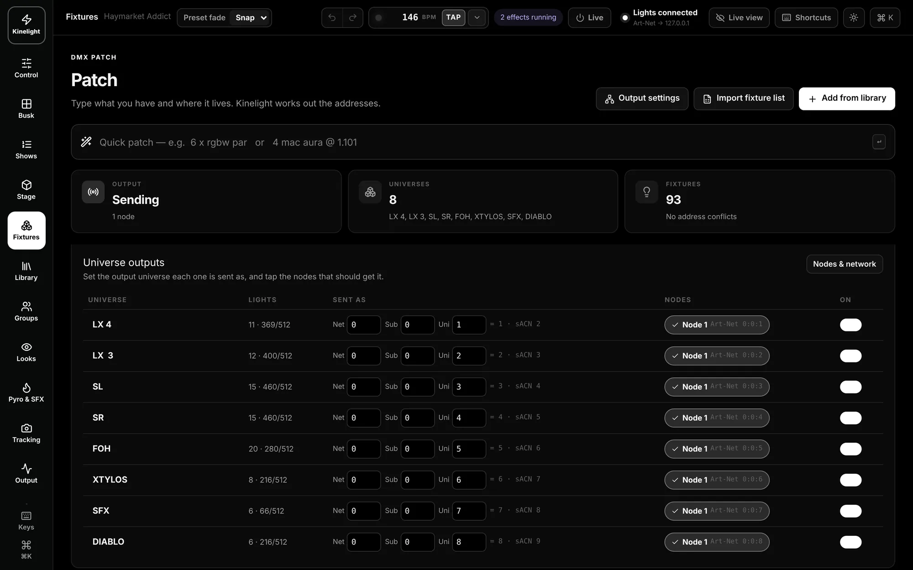

## And also

- **Camera tracking** — a camera at front of house, or a piece's rehearsal video, and Kinelight numbers each dancer so
  follow spots stay on a person or a group
- **Main and backup Macs** — every subscription includes both; choose which is which when you sign in and swap them
  any time, live on both sides
- **Works offline** — your licence lives on your Mac and checks in at least every 15 days; the light output is never
  cut in the middle of a show
- **Backups, always** — every change saved as you go, with a copy in Google Drive, Dropbox or iCloud if you like
- **Ideas and problems** — send them from the Account tab in the app, straight to the team

## Plans

Both plans include a main Mac and a backup Mac. Change plan whenever you like — your Macs pick it up within half a
minute.

| | **Kinelight** | **Kinelight Pro** |
|---|:---:|:---:|
| Control: groups, faders, GO, looks | ✓ | ✓ |
| Patch 670 fixture profiles | ✓ | ✓ |
| Stage plan and 3D | ✓ | ✓ |
| APC mini and MIDI controllers | ✓ | ✓ |
| Art-Net / sACN output | One node | Unlimited, with monitor and OSC |
| Busk | | ✓ |
| Shows and the timeline | | ✓ |
| Pyro & SFX | | ✓ |
| iPad & phone remote | | ✓ |
| Second screens and the video wall | | ✓ |
| Camera tracking | | ✓ |
| AI looks | | ✓ |

Monthly prices are on the website: **[see pricing →](https://kinelight.brnzy.co.uk/pricing)**

## Requirements

- A Mac with Apple silicon (M1 or later)
- macOS 12 Monterey or later
- An Art-Net or sACN node, or a DMX interface that speaks either
- For the remote: an iPad or phone on the same network (Kinelight Pro)

## Install

1. Subscribe at [kinelight.brnzy.co.uk](https://kinelight.brnzy.co.uk), then download Kinelight from your
   Subscriptions page or from [Releases](https://github.com/samjosephburns94-sys/kinelight.app/releases/latest).
2. Open the .dmg and drag **Kinelight** into **Applications**.
3. The first time, right-click Kinelight → **Open** → **Open**.
4. Press **Sign in**, sign in on the website, and choose whether this is your **main** or **backup** Mac.

---

## About this repository

This is Kinelight's public home on GitHub: this page, the **[releases](https://github.com/samjosephburns94-sys/kinelight.app/releases)**
of the Mac app and the **[changelog](CHANGELOG.md)**. The app's source and the website are private.

Found a problem or have an idea? Send it from **Kinelight → Account** in the app, or through
[the website](https://kinelight.brnzy.co.uk).

Built by <a href="https://brnzy.co.uk">BRNZY.co.uk</a> · Screenshots are the real app with a real show loaded

